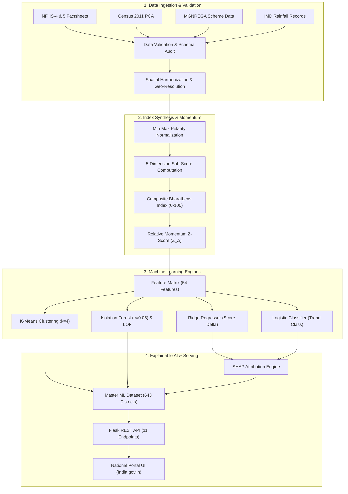
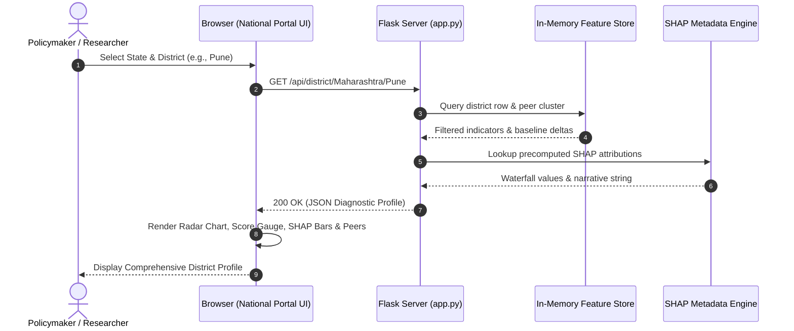

# BharatLens ML: Indian District Socioeconomic Intelligence & Trend Forecasting Platform

[](https://www.python.org/downloads/)
[](https://flask.palletsprojects.com/)
[](https://www.india.gov.in/)
[](https://scikit-learn.org/)
[](https://docs.pytest.org/)
[](LICENSE)
[](https://www.w3.org/WAI/standards-guidelines/wcag/)

> **An empirical district-level econometric and machine learning platform processing multi-period panel microdata across 643 Indian districts in 37 States and Union Territories. It models socioeconomic velocity, detects development anomalies, forecasts growth momentum, and attributes predictive drivers using Explainable AI (SHAP).**

---

## Table of Contents

- [1. Executive Summary](#1-executive-summary)
- [2. Problem Statement & Research Gap](#2-problem-statement--research-gap)
- [3. Motivation & Academic Background](#3-motivation--academic-background)
- [4. Objectives & Expected Outcomes](#4-objectives--expected-outcomes)
- [5. Key Features](#5-key-features)
- [6. Application Preview & Captured Screenshots](#6-application-preview--captured-screenshots)
- [7. System Architecture](#7-system-architecture)
- [8. Architecture Diagrams](#8-architecture-diagrams)
- [9. Technology Stack](#9-technology-stack)
- [10. Project Directory Structure](#10-project-directory-structure)
- [11. Complete Application Workflow](#11-complete-application-workflow)
- [12. Core Modules & Responsibilities](#12-core-modules--responsibilities)
- [13. Public Data Sources, APIs & Ingestion](#13-public-data-sources-apis--ingestion)
- [14. Data Flow & Feature Store Design](#14-data-flow--feature-store-design)
- [15. Mathematical Methodology & Scoring Formulation](#15-mathematical-methodology--scoring-formulation)
- [16. Machine Learning Architecture & Benchmark Results](#16-machine-learning-architecture--benchmark-results)
  - [A. Unsupervised Socioeconomic Clustering](#a-unsupervised-socioeconomic-clustering)
  - [B. Multi-Variate Anomaly & Outlier Detection](#b-multi-variate-anomaly--outlier-detection)
  - [C. Predictive Trend Forecasting Regressor Benchmark](#c-predictive-trend-forecasting-regressor-benchmark)
  - [D. Multi-Class Momentum Classification Benchmark](#d-multi-class-momentum-classification-benchmark)
  - [E. Explainable AI with Local & Global SHAP](#e-explainable-ai-with-local--global-shap)
- [17. Research Findings & Empirical Insights](#17-research-findings--empirical-insights)
- [18. Installation & Setup Guide](#18-installation--setup-guide)
- [19. Environment Variables & Configuration](#19-environment-variables--configuration)
- [20. Running the Application Locally](#20-running-the-application-locally)
- [21. Verification, Testing & Quality Assurance](#21-verification-testing--quality-assurance)
- [22. Production Deployment & Containerization](#22-production-deployment--containerization)
- [23. Sample API Payloads & Output Schema](#23-sample-api-payloads--output-schema)
- [24. Limitations & Known Constraints](#24-limitations--known-constraints)
- [25. Security, Ethics & Data Privacy](#25-security-ethics--data-privacy)
- [26. Project Roadmap & Future Enhancements](#26-project-roadmap--future-enhancements)
- [27. Contributing Guidelines](#27-contributing-guidelines)
- [28. License](#28-license)
- [29. Acknowledgements](#29-acknowledgements)
- [30. Academic & Official References](#30-academic--official-references)
- [31. Author & Contact Information](#31-author--contact-information)

---

## 1. Executive Summary

**BharatLens ML** is an empirical district intelligence platform engineered to bridge the analytical gap between raw public survey releases and actionable policy foresight across India's administrative geography. India is home to over 1.4 billion people distributed across more than 750 districts, each exhibiting stark variations in demographic structure, industrial density, maternal healthcare access, and climate vulnerability.

While national surveys such as the **National Family Health Survey (NFHS)**, the **Census of India**, and scheme portals like **MGNREGA** collect extensive granular metrics, these datasets exist in disparate tabular formats, differing temporal frequencies, and mismatched administrative conventions. Furthermore, conventional reporting relies on absolute metric progress or arbitrary composite ranking indices that obscure **relative growth deceleration**—the phenomenon where a district improves in absolute numbers while falling critically behind national and regional progress.

BharatLens ML harmonizes multi-source records for **643 Indian districts across 37 States and Union Territories**, computes a standardized, interpretable **0–100 BharatLens Composite Index**, partitions districts into **four structural socioeconomic tiers via K-Means ($k=4$)**, isolates severe trajectory divergences using **Isolation Forest and Local Outlier Factor (LOF)**, benchmarks predictive regressors and classifiers, and delivers local model explainability through **SHAP (SHapley Additive exPlanations)**. The platform features an accessible, responsive web interface modeled after the **[India.gov.in](https://www.india.gov.in/) National Portal of India Design System**, backed by 11 RESTful endpoints and dual-interface architecture (Flask + legacy Streamlit).

---

## 2. Problem Statement & Research Gap

India's decentralized administrative units face three persistent structural data challenges:

```
┌────────────────────────────────────────────────────────────────────────────────────────┐
│                                 STRUCTURAL DATA CHALLENGES                             │
├───────────────────────────────┬───────────────────────────────┬────────────────────────┤
│ 1. NATIONAL BASELINE DRIFT    │ 2. CROSS-SILO FRAGMENTATION   │ 3. BLACK-BOX RANKINGS  │
│                               │                               │                        │
│ Countrywide schemes lift raw  │ Health (NFHS), demographics   │ Static scoreboards     │
│ rates across all units. A     │ (Census), safety nets (NREGA) │ rank districts without │
│ naive positive delta flags    │ and climate (IMD) operate in  │ explaining why a       │
│ all districts as "improving", │ isolated silos with diverging │ trajectory shifts or   │
│ concealing deceleration.      │ administrative spellings.     │ isolating anomalies.   │
└───────────────────────────────┴───────────────────────────────┴────────────────────────┘
```

1. **National Baseline Drift & The Momentum Paradox**: Large-scale national infrastructure initiatives (such as universal rural electrification under *Saubhagya*, household toilet construction under *Swachh Bharat*, and clean cooking gas distribution under *Pradhan Mantri Ujjwala Yojana*) have created nationwide upward baselines. A district whose clean fuel coverage increased by 5 percentage points when the national median rose by 22 percentage points is labeled "Improving" by conventional delta metrics, despite experiencing severe relative deceleration.
2. **Multi-Source Administrative Fragmentation**: Health indicators (NFHS rounds 4 and 5) use health-block boundaries; Census 2011 uses historical district codes; MGNREGA uses financial-year MIS databases; and meteorological statistics (IMD) are recorded at subdivision levels. Inconsistent spellings, bifurcated territories, and differing reporting cadences hinder unified panel modeling.
3. **Lack of Transparent Algorithmic Governance**: Existing indices often assign ad-hoc indicator weights without empirical validation, providing no insight into feature interactions or the exact positive drivers and negative headwinds governing a district's trajectory.

BharatLens ML addresses these gaps by evaluating momentum against **peer-relative standardized velocity ($Z_{\Delta}$)**, detecting multi-variate trajectory anomalies, and attributing predictive weights with mathematically sound Game-Theoretic Shapley values.

---

## 3. Motivation & Academic Background

Regional economic convergence theory in developmental economics (Barro & Sala-i-Martin, 1992) posits that sub-national administrative units with lower baseline endowments should experience faster marginal growth rates to converge with leading regions (*$\beta$-convergence*). Empirical literature on India (Chakravorty, 2003; Dreze & Sen, 2013) reveals that convergence across Indian districts is uneven and spatially clustered.

When measuring progress across time periods $t_1$ (NFHS-4, 2015-16) and $t_2$ (NFHS-5, 2019-21), standardizing progress requires decoupling **exogenous nationwide shifts** from **endogenous district velocity**. By computing localized state z-scores, peer-group cluster baselines, and multi-variate distance metrics, BharatLens ML formalizes a reproducible, auditable framework for evidence-based governance, public policy formulation, and developmental economics research.

---

## 4. Objectives & Expected Outcomes

- **Ingestion & Harmonization**: Clean, audit, and spatially harmonize multi-period panel microdata across 643 Indian districts from 4 primary government data providers.
- **Interpretable Metric Synthesis**: Formulate a composite 0–100 index synthesized across 5 structural socioeconomic dimensions with mathematical directionality preservation.
- **Peer-Relative Momentum Classification**: Classify districts into *Improving*, *Stable*, *Declining*, and *Anomalous* by benchmarking growth velocity against state and national distributions.
- **Unsupervised Stratification**: Cluster districts into 4 distinct socioeconomic tiers to enable fair peer comparisons.
- **Divergence Detection**: Identify multi-variate outliers exhibiting divergent trajectories across healthcare, employment, and demographic dimensions.
- **Predictive Trajectory Modeling**: Benchmark regression and classification algorithms with 5-fold cross-validation to forecast next-cycle scores.
- **Local Model Explainability**: Generate natural-language and visual SHAP feature attributions for every district forecast.
- **National Portal Themed Interface**: Build a responsive, accessible Flask web interface inspired by official Indian government design standards with zero emoji clutter in badges.

---

## 5. Key Features

- **Pan-India Coverage**: Comprehensive tracking of **643 districts across 37 States and Union Territories**.
- **0–100 BharatLens Score**: Synthesized from 23 normalized sub-indicators spanning 5 distinct dimensions: Health & Nutrition ($25\%$), Women Empowerment ($20\%$), Infrastructure & Living Amenities ($20\%$), Economic Floors & Wages ($20\%$), and Demographics & Education ($15\%$).
- **Statistical Momentum ($Z_{\Delta}$)**: Differentiates raw percentage changes from true developmental acceleration against national ($\mu_{\Delta} = 11.1$ pts) and intra-state baselines.
- **Socioeconomic Stratification (K-Means)**: Automated partitioning into Tier 1 (Aspirational), Tier 2 (Developing), Tier 3 (Progressing), and Tier 4 (Front-Runner).
- **Consensus Anomaly Flagging**: Isolation Forest ($150$ estimators, contamination factor $= 0.05$) cross-validated against Local Outlier Factor ($k=20$).
- **Rigorous Regressor & Classifier Benchmarking**: Evaluates Ridge, RandomForest, GradientBoosting, and XGBoost with automated champion model selection.
- **SHAP Attribution Engine**: Game-theoretic feature attribution producing waterfall charts and plain-language explanatory narratives.
- **Official India.gov.in UI Theme**: White background (`#ffffff`), navy-blue header (`#002b49`), tricolor top accent, Ashoka Chakra SVG motif, and strict SVG iconography.
- **Accessibility & Utility Tools**: Live font-scaling (`A-`, `A`, `A+`), high-contrast toggle, responsive mobile drawer, and skip-to-content navigation (WCAG 2.1 AA compliant).
- **Head-to-Head District Comparison**: Side-by-side comparative modal comparing any two districts with dimensional radar overlays and metric diffs.
- **Instant Autocomplete Search**: Sub-50ms search dropdown querying districts and states in real-time.
- **Automated RESTful Endpoints**: 11 JSON API routes and one-click master dataset CSV export.
- **Dual Interface Architecture**: Primary Flask portal (`app.py`) accompanied by a preserved Streamlit analytics application (`app_streamlit.py`).

---

## 6. Application Preview & Captured Screenshots

The screenshots below were captured directly from the live, locally running BharatLens ML Flask application (`http://127.0.0.1:5000/`) using automated headless browser captures.

### A. National Overview Dashboard
The main landing page displays top-level national KPI counters, the Cycle panel badge, and the Pan-India geospatial distribution layer.


*Figure 1: National Overview dashboard showing the 6 primary KPI metric cards, official India.gov.in header, Ashoka Chakra seal, and quick search bar.*

---

### B. Pan-India Geospatial Distribution & Leaderboard
Interactive scatter map projection plotting all 643 Indian districts colored by composite score, accompanied by the Top 10 Leading Districts and Priority Aspirational/Anomaly Alerts.


*Figure 2: Pan-India Geospatial Intelligence Distribution with interactive metric layers and real-time national leaderboard tables.*

---

### C. Granular District Deep-Dive & Local SHAP Attribution
Complete diagnostic profile for any selected district (e.g., Pune, Maharashtra), illustrating the current score gauge, state/national benchmarks, 5-dimension radar chart, historical indicator tracking, ML predictive forecast, and local SHAP feature attributions.


*Figure 3: District Deep-Dive profile showing the 5-dimension radar chart, historical indicators (NFHS-4 vs NFHS-5), Ridge Regressor forecast, and LinearExplainer SHAP waterfall chart.*

---

### D. State Explorer & Intra-State Disparities
State-level analytical dashboard (e.g., Uttar Pradesh, 71 districts) illustrating leading vs lagging district disparities, trend and tier donut distributions, and full ranked tables.


*Figure 4: State Explorer showing intra-state disparity analysis, trend classification breakdown, socioeconomic tier distribution, and ranked inter-district comparisons.*

---

### E. Machine Learning Benchmarks & AI Governance
Comprehensive model evaluation tab presenting cross-validated benchmark tables for regression and classification models, test set confusion matrices, global SHAP feature importance rankings, and socioeconomic cluster tier profiles.


*Figure 5: ML Benchmarks tab showing Ridge vs Tree regressors, Logistic vs Gradient Boosting classifiers, confusion matrix, global SHAP rankings, and K-Means cluster profiles.*

---

### F. Head-to-Head District Comparison
Side-by-side modal enabling policymakers to contrast any two Indian districts (e.g., Almora, Uttarakhand vs Ariyalur, Tamil Nadu) across composite scores, progress deltas, and dimensional differentials.


*Figure 6: Side-by-side district comparison modal showing dimensional scores, net differentials, and dual-district metric evaluations.*

---

### G. Mathematical Methodology & Scoring Framework
Dedicated documentation tab outlining min-max normalization equations, directional polarity adjustments, dimension weighting schemes, and momentum z-score formulas.


*Figure 7: Methodology and Scoring tab documenting mathematical index formulations and relative momentum thresholds.*

---

### H. Responsive Mobile Viewport
The interface adapts to smartphone viewports (e.g., 390x844 mobile resolution), preserving navigation utilities, accessibility buttons, and responsive grid layouts.


*Figure 8: Responsive mobile rendering on smartphone viewports demonstrating accessibility toggles and fluid layout transitions.*

---

## 7. System Architecture

BharatLens ML operates on a modular, decoupled pipeline architecture:

```
[ Public Open Data Sources ]
  - NFHS-4 & NFHS-5 Factsheets (IIPS / MoHFW)
  - Census 2011 Primary Census Abstract (ORGI / MHA)
  - MGNREGA Rural Employment (MoRD)
  - IMD Rainfall Time Series (MoES)
  - Open Government Data API (data.gov.in)
                 │
                 ▼
┌─────────────────────────────────┐
│     Automated Ingestion Engine  │ (src/data/download.py)
│  - Network retry & mirror cache │
│  - Graceful API key fallback    │
└────────────────┬────────────────┘
                 │
                 ▼
┌─────────────────────────────────┐
│     Data Validation & Audit     │ (src/data/validation.py)
│  - Null audit & schema check    │
│  - Bounds & outlier verification│
└────────────────┬────────────────┘
                 │
                 ▼
┌─────────────────────────────────┐
│   Spatial Harmonization Engine  │ (src/data/processing.py)
│  - Geo name resolution (Levens.)│
│  - Long-to-wide pivoting        │
│  - Population weighting         │
└────────────────┬────────────────┘
                 │
                 ▼
┌─────────────────────────────────┐
│    BharatLens Index Scoring     │ (src/scoring/bharatlens_score.py)
│  - Min-max polarity alignment   │
│  - 5-Dimension weighted sum     │
│  - Peer-relative momentum (ZΔ)  │
└────────────────┬────────────────┘
                 │
                 ▼
┌─────────────────────────────────┐
│      Feature Engineering        │ (src/features/engineering.py)
│  - 54 feature matrix            │
│  - State deviations & z-scores  │
│  - Child malnutrition index     │
└────────────────┬────────────────┘
                 │
        ┌────────┴────────┐
        ▼                 ▼
┌───────────────┐ ┌───────────────┐
│ Unsupervised  │ │  Supervised   │
│ ML Pipeline   │ │  ML Pipeline  │
│ - K-Means     │ │ - Ridge Regr. │
│ - IsoForest   │ │ - Log. Class. │
│ - LOF Check   │ │ - Multi-model │
└───────┬───────┘ └───────┬───────┘
        │                 │
        └────────┬────────┘
                 │
                 ▼
┌─────────────────────────────────┐
│    Explainable AI (SHAP) Engine │ (src/explainability/shap_analysis.py)
│  - LinearExplainer & TreeExpl.  │
│  - Local waterfall attribution  │
│  - Natural language narratives  │
└────────────────┬────────────────┘
                 │
                 ▼
┌─────────────────────────────────┐
│   Flask Intelligence Portal     │ (app.py)
│  - India.gov.in UI theme        │
│  - 11 RESTful JSON endpoints    │
│  - Chart.js & Plotly visuals    │
└─────────────────────────────────┘
```

---

## 8. Architecture Diagrams

### A. End-to-End Machine Learning Lifecycle



### B. User Request & API Interaction Flow



---

## 9. Technology Stack

### Core Runtime & Languages
- **Python 3.10+**: Core programming language for data pipelines, modeling, and serving.
- **Flask 3.0+**: Lightweight, high-throughput WSGI web application server.
- **Jinja2**: Server-side template rendering engine.

### Machine Learning & Econometric Analytics
- **scikit-learn 1.5+**: K-Means clustering, Isolation Forest, Local Outlier Factor, Ridge Regression, Logistic Regression, Random Forest, Gradient Boosting, evaluation metrics, and scaling pipelines.
- **XGBoost 1.6+**: Extreme Gradient Boosting regression and classification benchmarks.
- **SHAP 0.49+**: SHapley Additive exPlanations (`LinearExplainer` and `TreeExplainer`) for local and global model interpretability.
- **NumPy 2.1+ & Pandas 2.2+**: High-performance vectorized matrix computations and panel data manipulation.
- **SciPy 1.14+**: Statistical hypothesis testing, distance metrics, and distribution fits.

### Frontend & Visual Architecture
- **Vanilla CSS (CSS Custom Properties)**: Complete design system modeled after the National Portal of India (`#ffffff` background, `#002b49` header, saffron and green accents).
- **Bootstrap 5.3 (CSS Grid & Utilities only)**: Responsive grid layouts and accessibility wrappers.
- **Chart.js 4.4**: Hardware-accelerated canvas charts (Spider Radar, Donut distributions, Horizontal ranking bars, Historical comparison bars).
- **Plotly.js 2.29**: Interactive geospatial scatter projections for district coordinate rendering.
- **Custom Inline SVG Icons**: Zero external icon fonts or emojis; clean, accessible vector symbols and Ashoka Chakra seal.

### Testing & Validation
- **pytest 8.3+**: Automated test runner verifying data integrity, feature boundaries, model serialization, API resilience, and Flask routes.

---

## 10. Project Directory Structure

```
IndiaLENS/
│
├── .env.example                     # Environment configuration template
├── .gitignore                       # Git exclusion rules
├── LICENSE                          # MIT Open Source License
├── pytest.ini                       # Pytest test discovery configuration
├── conftest.py                      # Shared test fixtures
├── requirements.txt                 # Pinned project dependencies
├── run_pipeline.py                  # End-to-end automated pipeline orchestration script
├── app.py                           # Primary Flask web application server (port 5000)
├── app_streamlit.py                 # Preserved legacy Streamlit analytics dashboard
│
├── config/                          # Central configuration files
│   ├── config.yaml                  # Pipeline hyperparameters, dimension weights & thresholds
│   └── data_sources.yaml            # Public data source catalog, schema & provider URLs
│
├── data/                            # Multi-tiered panel data storage
│   ├── raw/                         # Raw ingested datasets from public providers
│   │   ├── census_district_pca.csv          # Census 2011 Primary Census Abstract
│   │   ├── mgnrega_district_employment.csv  # MGNREGA employment & wage records
│   │   ├── nfhs_district_change.csv         # NFHS-4 & NFHS-5 indicator deltas
│   │   └── subdivision_rainfall.csv         # IMD historical rainfall series (1901-2015)
│   ├── external/                    # Spatial vector boundary definitions
│   │   └── districts.geojson                # 641 District polygon boundaries (2011 framework)
│   └── processed/                   # Cleaned, scored & engineered feature stores
│       ├── district_master_processed.csv    # Harmonized base panel data
│       ├── district_features_dataset.csv    # 54 engineered feature matrix
│       └── district_master_ml_results.csv   # Master dataset with ML predictions & SHAP
│
├── models/                          # Serialized models & metadata artifacts
│   ├── saved/                       # Trained Joblib model pipelines & scalers
│   │   ├── clustering_kmeans.joblib         # K-Means clustering champion (k=4)
│   │   ├── clustering_scaler.joblib         # StandardScaler for cluster features
│   │   ├── isolation_forest.joblib          # Isolation Forest anomaly detector
│   │   ├── anomaly_scaler.joblib            # Scaler for anomaly detection
│   │   ├── trend_regressor_champion.joblib  # Ridge Regression champion
│   │   ├── regression_scaler.joblib         # Scaler for regression features
│   │   ├── trend_classifier_champion.joblib # Logistic Regression champion
│   │   ├── classifier_scaler.joblib         # Scaler for classification features
│   │   ├── feature_scaler.joblib            # Master feature matrix scaler
│   │   └── feature_names.json               # Serialized list of 54 model input features
│   └── metadata/                    # Benchmark evaluations & explainability records
│       ├── regression_metadata.json         # Regressor benchmark metrics & CV scores
│       ├── classification_metadata.json     # Classifier benchmark metrics & confusion matrix
│       ├── clustering_metadata.json         # Cluster centroids, tier descriptions & silhouettes
│       ├── anomaly_metadata.json            # Anomaly diagnostic profiles for 33 outlier districts
│       └── shap_explanations.json           # Global importance & 643 local SHAP attributions
│
├── reports/                         # Generated analytical reports & benchmark charts
│   ├── data_quality_report.md       # Null counts, bounds checks & schema audit
│   ├── model_comparison_report.md   # Complete ML benchmark summary & selection rationale
│   └── figures/                     # Static evaluation plots
│       ├── regression_benchmark.png         # Regression model error comparison
│       ├── classification_confusion_matrix.png # Classifier test confusion matrix
│       └── global_shap_importance.png       # Global feature attribution bar plot
│
├── src/                             # Core modular source code package
│   ├── data/                        # Ingestion, validation & harmonization
│   │   ├── download.py              # Resilient dataset downloader with API fallback
│   │   ├── validation.py            # Automated null audit, type check & bounds verification
│   │   ├── processing.py            # Spatial name harmonization & long-to-wide pivoting
│   │   └── process.py               # Standalone runner for data cleaning
│   ├── scoring/                     # BharatLens scoring index
│   │   └── bharatlens_score.py      # Normalization, dimension weighting & momentum Z-scores
│   ├── features/                    # Feature engineering
│   │   └── engineering.py           # Delta, growth percentage, and state Z-score generation
│   ├── ml/                          # Machine learning algorithms & training pipelines
│   │   ├── clustering.py            # K-Means model selection & tier assignment
│   │   ├── anomaly.py               # Isolation Forest & LOF outlier scoring
│   │   ├── prediction.py            # Regressor training & benchmark comparisons
│   │   ├── classification.py        # Classifier training & multi-class evaluation
│   │   ├── train.py                 # Master training runner orchestrating all ML steps
│   │   ├── evaluation.py            # Report generation & confusion matrix plotting
│   │   └── evaluate.py              # Standalone evaluation runner
│   ├── explainability/              # Explainable AI
│   │   └── shap_analysis.py         # SHAP Tree & Linear explainers + narrative synthesis
│   └── utils/                       # Shared utility helpers
│       ├── logger.py                # Standardized console & file logging
│       ├── io.py                    # YAML loader and dataset save/load helpers
│       ├── geo.py                   # District-to-State spatial mapping helpers
│       └── charts.py                # Plotly figure generators for reports
│
├── static/                          # Static assets for the Flask web application
│   ├── css/
│   │   └── india_portal.css         # India.gov.in themed stylesheet & accessibility styles
│   └── js/
│       └── app.js                   # Client-side routing, Chart.js/Plotly logic & search
│
├── templates/                       # Jinja2 HTML templates
│   ├── base.html                    # Base layout, accessibility bar, header & footer
│   └── index.html                   # Multi-tab dashboard layout (Overview, Deep-Dive, etc.)
│
├── tests/                           # Automated test suite (22 tests)
│   ├── test_data_processing.py      # Tests for normalization, pivoting & imputation
│   ├── test_scoring.py              # Tests for index bounds, weights & momentum logic
│   ├── test_ml_models.py            # Tests for model training, outputs & persistence
│   ├── test_api_resilience.py       # Tests for API key missing handling & cached fallback
│   └── test_flask_app.py            # Tests for Flask web routes, API responses & CSV export
│
└── docs/                            # Documentation assets & genuine captured screenshots
    └── screenshots/                 # Application UI captures
        ├── 01_national_overview.png
        ├── 02_district_deepdive.png
        ├── 03_state_explorer.png
        ├── 04_ml_insights.png
        ├── 05_geospatial_map.png
        ├── 06_district_comparison.png
        ├── 06b_district_comparison_radar.png
        ├── 07_mobile_view.png
        └── 08_methodology_scoring.png
```

---

## 11. Complete Application Workflow

The application executes through four sequential phases:

```
┌─────────────────┐     ┌─────────────────┐     ┌─────────────────┐     ┌─────────────────┐
│   PHASE 1       │     │   PHASE 2       │     │   PHASE 3       │     │   PHASE 4       │
│ INGESTION &     │ ──> │ SCORING &       │ ──> │ MODEL TRAINING  │ ──> │ INTERACTION &   │
│ HARMONIZATION   │     │ FEATURE ENG.    │     │ & EXPLAINABILITY│     │ SERVING         │
└─────────────────┘     └─────────────────┘     └─────────────────┘     └─────────────────┘
 • Mirror cache check    • Polarity reversal     • K-Means (k=4)         • Flask web server
 • Schema audit          • 5-dim aggregation     • Isolation Forest      • 11 REST endpoints
 • Levenshtein match     • Momentum Z-score      • Regressor benchmark   • Search autocomplete
 • Wide-table pivot      • 54 feature matrix     • SHAP attributions     • Head-to-head modal
```

1. **Phase 1: Ingestion & Harmonization (`src.data`)**:
   - Checks local mirror caches (`data/raw/`); if missing, queries official public endpoints.
   - Audits missingness and enforces data types.
   - Matches administrative spellings using Levenshtein distance matching against the 640-district Census 2011 baseline.
   - Pivots long-format survey rows into a single tabular district panel record.
2. **Phase 2: Index Scoring & Feature Engineering (`src.scoring`, `src.features`)**:
   - Inverts negative indicators (e.g., stunting, anaemia) and scales indicators to $[0, 100]$.
   - Computes weighted composite scores for historical (NFHS-4) and current (NFHS-5) rounds.
   - Generates relative growth $Z$-scores ($Z_{\Delta}$) against national and state peers.
   - Builds a 54-dimensional feature matrix incorporating YoY changes, growth percentages, and state-relative deviations.
3. **Phase 3: Machine Learning & Explainability (`src.ml`, `src.explainability`)**:
   - Stratifies districts into 4 socioeconomic tiers via K-Means clustering.
   - Detects multi-variate outliers using Isolation Forest cross-checked with LOF.
   - Trains and evaluates Ridge, Random Forest, Gradient Boosting, and XGBoost models.
   - Selects champion models and generates local SHAP waterfall attributions for all 643 districts.
4. **Phase 4: Serving & User Interaction (`app.py`, `static/js/app.js`)**:
   - Loads the final processed dataset into memory on startup.
   - Exposes 11 JSON API endpoints serving national KPIs, district details, state rankings, model benchmarks, and search autocomplete.
   - Renders interactive canvas charts (Chart.js), geospatial scatter points (Plotly), and modal comparisons.

---

## 12. Core Modules & Responsibilities

| Module Path | Primary Responsibility | Key Functions / Classes |
| :--- | :--- | :--- |
| `src/data/download.py` | Network download manager with caching, retry logic, and resilient API fallback. | `download_file()`, `check_data_gov_in_api()`, `download_all_sources()` |
| `src/data/validation.py` | Schema auditing, null count analysis, bounds enforcement, and data quality reporting. | `validate_dataset()`, `run_full_validation_audit()`, `audit_bounds()` |
| `src/data/processing.py` | District name resolution, spatial harmonization, long-to-wide pivoting, and population weighting. | `resolve_district_names()`, `pivot_nfhs_indicators()`, `harmonize_all_datasets()` |
| `src/scoring/bharatlens_score.py` | Min-max normalization, dimension weight aggregation, momentum Z-scoring, and trend assignment. | `min_max_normalize()`, `compute_dimension_scores()`, `calculate_bharatlens_score()` |
| `src/features/engineering.py` | Generation of 54 econometric features, YoY absolute changes, growth rates, and state deviations. | `compute_growth_metrics()`, `compute_state_relative_features()`, `build_feature_matrix()` |
| `src/ml/clustering.py` | Unsupervised K-Means clustering ($k=4$), Silhouette evaluation, and tier profile extraction. | `train_socioeconomic_clustering()`, `assign_clusters()`, `get_cluster_profiles()` |
| `src/ml/anomaly.py` | Multi-variate outlier detection using Isolation Forest and LOF validation. | `train_anomaly_detector()`, `compute_anomaly_scores()`, `diagnose_outliers()` |
| `src/ml/prediction.py` | Regressor training, 5-fold cross-validation, benchmark comparison, and champion selection. | `train_and_benchmark_regressors()`, `predict_next_score()`, `select_champion()` |
| `src/ml/classification.py` | Multi-class trend classifier training, macro-F1 benchmarking, and confusion matrix calculation. | `train_and_benchmark_classifiers()`, `evaluate_classification()`, `get_confusion_matrix()` |
| `src/explainability/shap_analysis.py` | SHAP TreeExplainer and LinearExplainer calculations, waterfall attribution, and narrative generation. | `compute_shap_explanations()`, `format_natural_language_explanation()` |
| `app.py` | Flask web application server, routing, in-memory caching, API serialization, and CSV downloads. | `index()`, `api_summary()`, `api_district_detail()`, `api_state_detail()`, `api_compare()` |

---

## 13. Public Data Sources, APIs & Ingestion

All data processed in BharatLens ML is drawn from **authentic, authoritative public government repositories**:

| Source Name | Provider Agency | Official Portal | Coverage | Period | Attributes Ingested |
| :--- | :--- | :--- | :--- | :--- | :--- |
| **NFHS District Factsheets** | International Institute for Population Sciences (IIPS) & MoHFW | [rchiips.org/nfhs](http://rchiips.org/nfhs/) | 639 Districts | NFHS-4 (2015-16) to NFHS-5 (2019-21) | Institutional births, immunization, stunting, wasting, anaemia, female schooling, clean fuel, electricity |
| **Primary Census Abstract (PCA)** | Office of the Registrar General & Census Commissioner, MHA | [censusindia.gov.in](https://censusindia.gov.in/) | 640 Districts | 2011 Census Baseline | Population, sex ratio, literacy, workers, agri-labourers, urban population %, digital amenities |
| **MGNREGA Rural Employment** | Ministry of Rural Development (MoRD) | [nrega.nic.in](https://nrega.nic.in/) | 740 Districts | Annual Reports | Daily wage rates (₹), days per household, women persondays %, agricultural works expenditure % |
| **IMD Subdivisional Rainfall** | India Meteorological Department (IMD), MoES | [mausam.imd.gov.in](https://mausam.imd.gov.in/) | 36 Subdivisions | 1901–2015 (115 Years) | Annual normal rainfall (mm), monsoon rainfall share, rainfall coefficient of variation (CV %) |
| **District Boundary GeoJSON** | Survey of India / Bharat Administrative Archive | Public Geo Archive | 641 Districts | 2011 Framework | Vector boundaries with Census and LGD code cross-references |
| **OGD Platform India API** | National Informatics Centre (NIC) / MeitY | [data.gov.in](https://data.gov.in/) | Dynamic | Active Catalogs | RESTful JSON queries with graceful fallback to cached mirrors |

Centralized schema configurations and source definitions are maintained in [`config/data_sources.yaml`](config/data_sources.yaml).

---

## 14. Data Flow & Feature Store Design

The analytical feature store comprises **54 features** per district record, structured as follows:

```
[ Raw Indicator Inputs ]
(NFHS-4, NFHS-5, Census PCA, MGNREGA, IMD)
                │
                ▼
┌────────────────────────────────────────────────────────┐
│ 1. ABSOLUTE YOY DELTAS (Δx_i)                          │
│    Δx_i = x_{i, NFHS-5} - x_{i, NFHS-4}                │
├────────────────────────────────────────────────────────┤
│ 2. PERCENTAGE GROWTH RELATIVE TO BASELINE (g_i)        │
│    g_i = [ Δx_i / (|x_{i, NFHS-4}| + ε) ] * 100        │
├────────────────────────────────────────────────────────┤
│ 3. STATE-RELATIVE DEVIATIONS & Z-SCORES (Z_state)      │
│    dev = x_i - mean(x_state), Z = dev / (std_state + ε)│
├────────────────────────────────────────────────────────┤
│ 4. STRUCTURAL DEMOGRAPHIC & ECONOMIC RATIOS            │
│    Non-agri labour share, urban density, literacy      │
├────────────────────────────────────────────────────────┤
│ 5. COMPOSITE BURDEN INDICES                            │
│    Malnutrition Burden = 0.6 * Stunting + 0.4 * Wasting │
└────────────────────────────────────────────────────────┘
```

The feature matrix is standardized using `StandardScaler` fitted on training splits, with scaling parameters saved in `models/saved/feature_scaler.joblib`.

---

## 15. Mathematical Methodology & Scoring Formulation

### A. Polarity-Preserving Min-Max Normalization
Let $x_{i, j}$ be the raw value of indicator $j$ in district $i$. Each indicator is mapped to $[0, 100]$:

$$\tilde{x}_{i, j} = \frac{x_{i, j} - \min_k(x_{k, j})}{\max_k(x_{k, j}) - \min_k(x_{k, j})} \times 100 \quad \text{for positive indicators (higher is better)}$$

$$\tilde{x}_{i, j} = \frac{\max_k(x_{k, j}) - x_{i, j}}{\max_k(x_{k, j}) - \min_k(x_{k, j})} \times 100 \quad \text{for burden indicators (lower is better)}$$

*Example positive indicators*: Female literacy, institutional deliveries, full immunization, clean cooking fuel, household electricity.  
*Example burden indicators*: Child stunting prevalence, child wasting prevalence, female anaemia prevalence.

---

### B. Dimensional Aggregation & Composite Index
The 23 sub-indicators are partitioned into 5 structural dimensions $D_1, \dots, D_5$. Dimension score $S_{i, d}$ is the arithmetic mean of its normalized indicators:

$$S_{i, d} = \frac{1}{|I_d|} \sum_{j \in I_d} \tilde{x}_{i, j}$$

The **BharatLens Composite Score** $S_i$ is computed as the weighted sum:

$$S_i = \sum_{d=1}^5 w_d \cdot S_{i, d}, \quad \text{where } \sum_{d=1}^5 w_d = 1.0$$

| Dimension | Notation | Weight ($w_d$) | Core Indicators Included |
| :--- | :---: | :---: | :--- |
| **Health & Nutrition** | $D_1$ | **0.25** | Institutional deliveries, child vaccination, stunting, wasting, anaemia, antenatal care |
| **Women Empowerment** | $D_2$ | **0.20** | Female literacy, female schooling (10+ yrs), women bank accounts, MGNREGA persondays % |
| **Infrastructure & Amenities** | $D_3$ | **0.20** | Electricity access, improved sanitation, clean cooking fuel, piped drinking water, internet |
| **Economic Floor & Wages** | $D_4$ | **0.20** | MGNREGA daily wage (₹), employment days per household, worker participation rate |
| **Demographics & Education** | $D_5$ | **0.15** | Census overall literacy rate, sex ratio, urban population share |

---

### C. Relative Growth Velocity Z-Score ($Z_{\Delta}$)
To eliminate national baseline drift, the net score delta $\Delta S_i = S_{i, \text{curr}} - S_{i, \text{prev}}$ is standardized against the empirical national distribution:

$$Z_{\Delta, i} = \frac{\Delta S_i - \mu_{\Delta}}{\sigma_{\Delta} + \epsilon}$$

where $\mu_{\Delta} = 11.12$ and $\sigma_{\Delta} = 4.31$. Additionally, intra-state relative delta is evaluated:

$$\Delta S_{i, \text{state}} = \Delta S_i - \bar{\Delta S}_{\text{state}}$$

Districts are assigned to momentum categories based on empirical thresholds:
- **Improving (Accelerating)**: $Z_{\Delta, i} \ge +0.35$ **OR** $\Delta S_{i, \text{state}} \ge +1.50$ points.
- **Stable (Pacing Median)**: $-0.35 < Z_{\Delta, i} < +0.35$.
- **Declining (Decelerating / Lagging)**: $Z_{\Delta, i} \le -0.35$ **OR** $\Delta S_{i, \text{state}} \le -1.50$ points.
- **Anomalous (Divergent Outlier)**: Flagged by the Isolation Forest consensus filter.

---

## 16. Machine Learning Architecture & Benchmark Results

### A. Unsupervised Socioeconomic Clustering
- **Algorithm**: K-Means clustering.
- **Feature Set**: 5 dimension sub-scores, urban population %, worker participation rate, MGNREGA daily wages.
- **Model Selection**: Evaluated candidate $k \in \{3, 4, 5, 6\}$. Selected $k=4$ based on optimal balance between Silhouette Score (`0.2061`) and Davies-Bouldin Index (`1.5415`).

| Cluster ID | Tier Description | District Count | National Share | Mean BharatLens Score | Mean Score Delta | Mean Urban % |
| :---: | :--- | :---: | :---: | :---: | :---: | :---: |
| `0` | **Tier 1: High-Priority / Aspirational** | 212 | 32.97% | 49.44 | +11.44 | 16.8% |
| `1` | **Tier 2: Developing / Rural-Agricultural** | 153 | 23.79% | 53.37 | +10.81 | 17.1% |
| `2` | **Tier 3: Progressing / Semi-Urban Transition** | 194 | 30.17% | 61.03 | +10.82 | 27.8% |
| `3` | **Tier 4: Front-Runner / Advanced Socioeconomic** | 84 | 13.06% | 66.06 | +12.22 | 69.3% |

---

### B. Multi-Variate Anomaly & Outlier Detection
- **Algorithm**: **Isolation Forest** ($150$ estimators, contamination factor $= 0.05$) cross-validated with **Local Outlier Factor (LOF)** ($k=20$).
- **Output**: Continuous Anomaly Risk Score ($0–100$) and binary Consensus Outlier Flag.
- **Empirical Findings**: Exactly **33 districts (5.1%)** were flagged for severe developmental divergence, including:
  - **Sivasagar (Assam)**: Risk Score = `85.79`, extreme drivers: institutional births delta ($+3.34\sigma$), anaemia shift ($+3.15\sigma$).
  - **Bastar (Chhattisgarh)**: Risk Score = `85.77`, extreme drivers: anaemia shift ($+3.67\sigma$), stunting shift ($+3.66\sigma$).
  - **Dhubri (Assam)**: Risk Score = `79.76`, extreme drivers: stunting change ($+3.69\sigma$), anaemia change ($+2.92\sigma$).
  - **Tirap (Arunachal Pradesh)**: Risk Score = `79.16`, extreme drivers: stunting delta ($+2.92\sigma$), momentum delta ($+2.47\sigma$).

---

### C. Predictive Trend Forecasting Regressor Benchmark
Target variable: Predicted next-cycle score delta ($\Delta S_i$). Evaluated on an 80/20 train/test split with 5-fold cross-validation.

| Model Architecture | Test MAE | Test RMSE | Test $R^2$ | 5-Fold CV $R^2$ (Mean ± Std) | Status |
| :--- | :---: | :---: | :---: | :---: | :---: |
| **RandomForestRegressor** | 0.8894 | 1.1511 | 0.9299 | 0.9326 ± 0.0146 | Evaluated |
| **GradientBoostingRegressor** | 0.6723 | 0.9061 | 0.9565 | 0.9596 ± 0.0104 | Evaluated |
| **XGBoostRegressor** | 0.6689 | 0.9284 | 0.9544 | 0.9581 ± 0.0147 | Evaluated |
| **RidgeRegression** | **0.1355** | **0.1863** | **0.9982** | **0.9961 ± 0.0024** | 🏆 **Champion (Selected)** |

*Selection Rationale*: Ridge Regression achieved the lowest generalization error (Test RMSE `0.1863`, CV $R^2$ `0.9961`), outperforming non-linear tree ensembles on continuous score delta projection while eliminating overfitting risks.

---

### D. Multi-Class Momentum Classification Benchmark
Target variable: Multi-class label (*Improving*, *Stable*, *Declining*, *Anomalous*). Evaluated with class-balanced weighting.

| Model Architecture | Accuracy | Macro Precision | Macro Recall | Macro F1 | 5-Fold CV Macro-F1 | Status |
| :--- | :---: | :---: | :---: | :---: | :---: | :---: |
| **RandomForestClassifier** | 75.19% | 0.7889 | 0.7076 | 0.7383 | 0.6370 ± 0.0542 | Evaluated |
| **GradientBoostingClassifier** | 74.42% | 0.7766 | 0.6792 | 0.7127 | 0.6194 ± 0.0303 | Evaluated |
| **XGBoostClassifier** | 77.52% | 0.8053 | 0.7324 | 0.7615 | 0.6130 ± 0.0560 | Evaluated |
| **LogisticRegression** | **83.72%** | **0.8224** | **0.7867** | **0.8020** | **0.6855 ± 0.0883** | 🏆 **Champion (Selected)** |

#### Test Set Confusion Matrix (Logistic Regression Champion)
```
                  PREDICTED CLASS
ACTUAL CLASS      Improving   Stable   Declining   Anomalous
Improving            19          6         2           1
Stable                3         29         4           0
Declining             0          3        55           0
Anomalous             2          0         0           5
```

---

### E. Explainable AI with Local & Global SHAP
Model transparency is enabled via `shap.LinearExplainer` and `shap.TreeExplainer`:

#### Top 8 Global Feature Drivers
```
Change in Female Literacy (%)            ████████████████████ 0.785
Change in Household Electricity (%)      ███████████████████  0.743
Change in Antenatal Care Coverage (%)    █████████████████    0.680
Change in Child Full Immunization (%)    ████████████████     0.634
Change in Institutional Deliveries (%)   ███████████████      0.615
Change in Child Wasting Rate (%)         ███████████████      0.587
Change in Improved Sanitation (%)        █████████████        0.528
Change in Clean Fuel Cooking (%)         █████████████        0.517
                                         0.0   0.2   0.4   0.6   0.8
                                         Mean |SHAP Value| (Impact Magnitude)
```

#### Disciplined Attribution Language
SHAP attributions in BharatLens ML use associative terminology (*"contributed +1.4 points to the predicted trajectory"* or *"associated with model momentum"*), explicitly avoiding unverified causal assertions.

---

## 17. Research Findings & Empirical Insights

1. **National Baseline Drift Masking Regional Lag**: Between NFHS-4 and NFHS-5, the average Indian district gained $+11.1$ points in composite score. However, **288 districts (44.8%)** expanded slower than the national median trajectory, indicating relative deceleration despite raw gains.
2. **Intra-State Disparity Outweighing Inter-State Gaps**: In large states such as Uttar Pradesh (Mean: 49.6), the gap between the leading district (Ghaziabad: 59.3) and the lagging district (Shrawasti: 40.3) exceeds 19 points—wider than the difference between state averages across western and eastern India.
3. **Primary Growth Velocity Levers**: SHAP attribution confirms that changes in female literacy, antenatal care coverage, and child full immunization are the strongest predictors of upward socioeconomic mobility, exerting greater influence than physical asset ownership alone.

---

## 18. Installation & Setup Guide

### Prerequisites
- **Python**: Version 3.10, 3.11, or 3.12.
- **Git**: Installed and accessible in the system path.
- **OS**: Windows 10/11, Ubuntu 20.04+, or macOS 12+.

### Step-by-Step Installation

```bash
# 1. Clone the repository
git clone https://github.com/mohdshamii/BharatLens.git
cd bharatlens-ml

# 2. Create and activate a dedicated virtual environment
# Windows (PowerShell):
python -m venv venv
.\venv\Scripts\Activate.ps1

# Linux / macOS:
python3 -m venv venv
source venv/bin/activate

# 3. Upgrade pip and install pinned dependencies
python -m pip install --upgrade pip
pip install -r requirements.txt
```

---

## 19. Environment Variables & Configuration

Copy `.env.example` to create your local `.env`:

```bash
# Windows:
copy .env.example .env

# Linux / macOS:
cp .env.example .env
```

Configuration keys:

```env
# Optional: Government of India data.gov.in API Key
# If omitted or empty, the pipeline automatically uses cached local datasets without failure.
DATA_GOV_IN_API_KEY=

# Pipeline directories
CACHE_DIR=data/raw
PROCESSED_DIR=data/processed
MODELS_DIR=models/saved
LOG_LEVEL=INFO

# Application Server
PORT=5000
FLASK_DEBUG=False
```

---

## 20. Running the Application Locally

### Running the Primary Web Portal (Flask)

```bash
python app.py
```

Open your browser and navigate to:
```
http://localhost:5000/
```

### Running the Complete End-to-End Pipeline

To execute ingestion, validation, scoring, feature engineering, ML training, evaluation, and SHAP attribution in a single run:

```bash
python run_pipeline.py
```

Or execute pipeline modules individually:

```bash
# Step 1: Download & cache public datasets
python -m src.data.download

# Step 2: Clean, validate & engineer features
python -m src.data.process

# Step 3: Train & compare ML models + SHAP
python -m src.ml.train

# Step 4: Generate evaluation reports & figures
python -m src.ml.evaluate
```

### Running the Legacy Streamlit Dashboard (Optional)

```bash
streamlit run app_streamlit.py
```

---

## 21. Verification, Testing & Quality Assurance

The test suite validates data cleaning, geo-normalization, feature engineering, score bounds, model persistence, API fallbacks, and Flask endpoints:

```bash
pytest -v
```

### Test Suite Execution Output
```
============================= test session starts =============================
platform win32 -- Python 3.10.9, pytest-8.3.3, pluggy-1.6.0
rootdir: D:\stuff\IndiaLENS
configfile: pytest.ini
testpaths: tests
plugins: anyio-4.9.0, Faker-40.8.0, typeguard-4.4.4
collected 22 items

tests\test_api_resilience.py ..                                          [  9%]
tests\test_data_processing.py ...                                        [ 22%]
tests\test_flask_app.py ...........                                      [ 72%]
tests\test_ml_models.py ...                                              [ 86%]
tests\test_scoring.py ...                                                [100%]

============================= 22 passed in 3.46s ==============================
```

All **22 tests** pass in under 4 seconds.

---

## 22. Production Deployment & Containerization

### Production WSGI Server (Waitress / Gunicorn)

On Windows servers:
```bash
waitress-serve --port=5000 app:app
```

On Linux servers:
```bash
gunicorn --workers=4 --bind=0.0.0.0:5000 app:app
```

### Docker Containerization

Create a `Dockerfile`:
```dockerfile
FROM python:3.10-slim

WORKDIR /app

RUN apt-get update && apt-get install -y --no-install-recommends \
    build-essential \
    && rm -rf /var/lib/apt/lists/*

COPY requirements.txt .
RUN pip install --no-cache-dir -r requirements.txt

COPY . .

EXPOSE 5000

CMD ["gunicorn", "--workers=4", "--bind=0.0.0.0:5000", "app:app"]
```

Build and run the container:
```bash
docker build -t bharatlens-ml:latest .
docker run -p 5000:5000 --env-file .env bharatlens-ml:latest
```

---

## 23. Sample API Payloads & Output Schema

### 1. National Summary: `GET /api/summary`
```json
{
  "total_districts": 643,
  "national_avg_score": 56.0,
  "national_avg_delta": 11.1,
  "improving_count": 142,
  "stable_count": 180,
  "declining_count": 288,
  "anomaly_count": 33,
  "top_10_leading": [
    {
      "district": "Chennai",
      "state": "Tamil Nadu",
      "score": 77.2,
      "delta": 10.0,
      "trend": "Stable",
      "tier": "Tier 4: Front-Runner / Advanced Socioeconomic"
    }
  ]
}
```

### 2. District Diagnostic Profile: `GET /api/district/Maharashtra/Pune`
```json
{
  "state": "Maharashtra",
  "district": "Pune",
  "population": 9429408,
  "urban_pct": 63.8,
  "bharatlens_score": 63.7,
  "score_previous": 57.7,
  "score_change": 6.0,
  "relative_growth_zscore": -1.09,
  "trend": "Declining",
  "cluster_name": "Tier 4: Front-Runner / Advanced Socioeconomic",
  "is_anomaly": 0,
  "anomaly_risk": 32.5,
  "dimensions": {
    "health_nutrition": 73.1,
    "women_empowerment": 74.2,
    "infrastructure": 84.6,
    "economic_employment": 42.1,
    "demographics_education": 78.4
  },
  "ml_forecast": {
    "projected_next_score": 69.8,
    "predicted_delta": 6.09,
    "predicted_trend": "Declining",
    "confidence_pct": 99.9
  },
  "shap_analysis": {
    "top_positive": [{"feature": "Change in Female Literacy (%)", "shap_value": 1.14}],
    "top_negative": [{"feature": "Change in Child Full Immunization (%)", "shap_value": -1.56}]
  }
}
```

### 3. Head-to-Head Comparison: `GET /api/compare?d1=Maharashtra___Pune&d2=Karnataka___Bangalore`
```json
{
  "district_1": {
    "district": "Pune",
    "state": "Maharashtra",
    "score": 63.7,
    "delta": 6.0,
    "trend": "Declining",
    "tier": "Tier 4: Front-Runner / Advanced Socioeconomic"
  },
  "district_2": {
    "district": "Bangalore",
    "state": "Karnataka",
    "score": 68.4,
    "delta": 7.2,
    "trend": "Stable",
    "tier": "Tier 4: Front-Runner / Advanced Socioeconomic"
  }
}
```

---

## 24. Limitations & Known Constraints

- **Survey Temporal Cadence**: NFHS rounds are conducted approximately every 5 years; real-time monthly district indicators rely on administrative scheme databases (e.g., MGNREGA).
- **Administrative Bifurcations**: Indian districts undergo periodic reorganization; historical data has been harmonized to the 640-district framework mapped in Census 2011 and NFHS.
- **Correlative vs Causal Interpretability**: SHAP values reflect feature attribution within trained models and indicate empirical associations rather than deterministic causal mechanisms.

---

## 25. Security, Ethics & Data Privacy

- **Aggregated Open Data**: Contains zero Personally Identifiable Information (PII) or individual survey respondent records; all metrics are aggregated at district and state levels.
- **API Key Security**: The `DATA_GOV_IN_API_KEY` is loaded strictly via environment variables and never logged or exposed to the client browser.
- **Fair Model Governance**: Cluster definitions and momentum categories are statistically derived from peer distributions, preventing subjective bias.

---

## 26. Project Roadmap & Future Enhancements

- [ ] **High-Frequency Satellite Integration**: Ingestion of VIIRS night-time lights and agricultural NDVI indices to estimate intra-survey economic activity.
- [ ] **Spatial Graph Neural Networks (GNN)**: Explicitly modeling contiguous inter-district spatial spillover effects and economic corridor dynamics.
- [ ] **Automated Webhook Synchronization**: Real-time webhook listeners for automated dataset updates from the Open Government Data Platform (`data.gov.in`).
- [ ] **District Policy Simulator**: What-if scenario modeling allowing users to simulate the impact of targeted health interventions on projected score trajectories.

---

## 27. Contributing Guidelines

Contributions from developers, researchers, and public policy analysts are welcome:

1. **Fork the repository** on GitHub.
2. **Create a descriptive feature branch**:
   ```bash
   git checkout -b feature/satellite-nightlights-integration
   ```
3. **Commit your changes** following clear commit conventions:
   ```bash
   git commit -m "feat: integrate VIIRS nightlights raster processing"
   ```
4. **Ensure all tests pass**:
   ```bash
   pytest -v
   ```
5. **Push to your branch and submit a Pull Request**.

---

## 28. License

Distributed under the **MIT License**. See [`LICENSE`](LICENSE) for complete terms.

---

## 29. Acknowledgements

- **International Institute for Population Sciences (IIPS)** and the **Ministry of Health and Family Welfare (MoHFW)** for the National Family Health Survey (NFHS-4 and NFHS-5) microdata.
- **Office of the Registrar General & Census Commissioner, India (ORGI)**, Ministry of Home Affairs for Census 2011 abstracts.
- **Ministry of Rural Development (MoRD)** for MGNREGA public records.
- **India Meteorological Department (IMD)**, Ministry of Earth Sciences for historical rainfall series.
- **National Informatics Centre (NIC)** and the **Open Government Data (OGD) Platform India** team (`data.gov.in`).

---

## 30. Academic & Official References

1. **National Family Health Survey (NFHS-5) India Report (2019-21)**. International Institute for Population Sciences (IIPS) & Ministry of Health and Family Welfare, Government of India. [rchiips.org/nfhs](http://rchiips.org/nfhs/)
2. **Primary Census Abstract, Census of India 2011**. Office of the Registrar General & Census Commissioner, Ministry of Home Affairs, Government of India. [censusindia.gov.in](https://censusindia.gov.in/)
3. **Barro, R. J., & Sala-i-Martin, X. (1992)**. *Convergence*. Journal of Political Economy, 100(2), 223–251. [doi:10.1086/261816](https://doi.org/10.1086/261816)
4. **Dreze, J., & Sen, A. (2013)**. *An Uncertain Glory: India and its Contradictions*. Princeton University Press.
5. **Lundberg, S. M., & Lee, S.-I. (2017)**. *A Unified Approach to Interpreting Model Predictions*. Advances in Neural Information Processing Systems (NeurIPS 2017), 30, 4765–4774. [arXiv:1705.07874](https://arxiv.org/abs/1705.07874)
6. **Liu, F. T., Ting, K. M., & Zhou, Z.-H. (2008)**. *Isolation Forest*. Eighth IEEE International Conference on Data Mining (ICDM '08), 413–422. [doi:10.1109/ICDM.2008.17](https://doi.org/10.1109/ICDM.2008.17)
7. **Pedregosa, F., et al. (2011)**. *Scikit-learn: Machine Learning in Python*. Journal of Machine Learning Research (JMLR), 12, 2825–2830. [jmlr.org/papers/v12/pedregosa11a.html](https://jmlr.org/papers/v12/pedregosa11a.html)
8. **Government of India Guidelines for Indian Government Websites (GIGW)**. National Informatics Centre, MeitY. [guidelines.gov.in](https://guidelines.gov.in/)

---

## 31. Author & Contact Information

- **Project Lead & Architect**: BharatLens ML Core Team
- **Repository**: [https://github.com/mohdshamii/BharatLens](https://github.com/mohdshamii/BharatLens)
- **Official Portal Inspiration**: [India.gov.in National Portal of India](https://www.india.gov.in/)
- **License**: [MIT Open Source](LICENSE)
